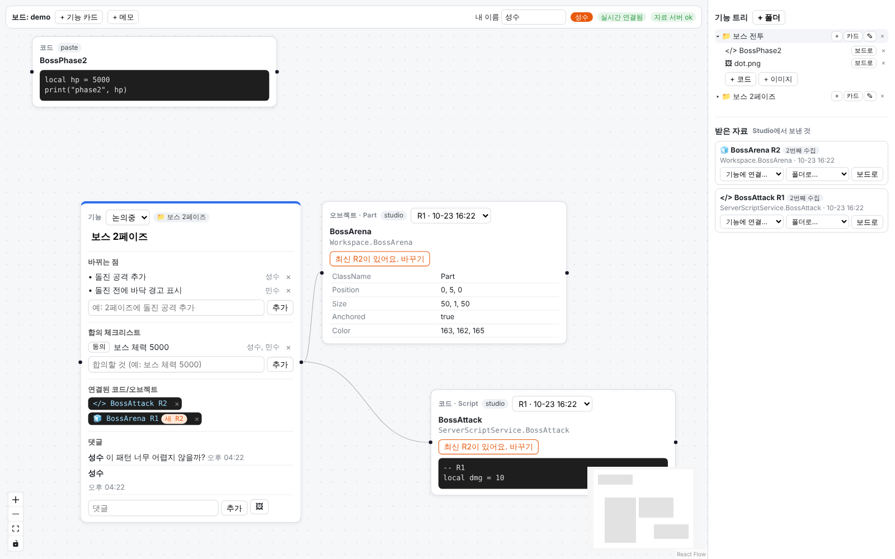

# 협업 보드 (Roblox 팀용)

기획자와 개발자가 한 보드에 모여 **기능 하나를 놓고** 이야기하는 도구입니다.
Studio에서 스크립트와 오브젝트를 보드로 보내고, 기능 카드에 붙여서 무엇이 바뀌는지, 무엇에 합의했는지를 같이 정리합니다.



## 지금 되는 것

- **기능 카드**: 제목, 상태(논의중/합의됨/구현중/완료), 바뀌는 점 목록, 합의 체크리스트(사람마다 "동의" 누름), 연결된 코드/오브젝트 칩, 댓글(이미지 첨부 가능)
- **자료 카드**: 코드(스크립트 본문), 오브젝트(속성 표), 이미지. 같은 스크립트를 여러 번 보내면 R1, R2 ... 로 쌓이고 카드에서 버전을 바꿔볼 수 있음
- **메모 카드**: 자유롭게 적는 포스트잇. 두 사람이 같이 써도 글자 단위로 합쳐짐
- **오른쪽 기능 트리**: 기능 폴더(하위 폴더 가능) → 자료 보관. "보드로" 버튼이나 끌어다 놓기로 보드에 꺼냄. 폴더의 "카드" 버튼으로 기능 카드 만들기
- **받은 자료**: Studio 플러그인이 보낸 것이 여기 쌓임. "기능에 연결"을 고르면 기능 카드에 칩이 붙고 그 기능 폴더로 정리됨
- **실시간**: 같은 보드에 들어온 사람끼리 카드, 위치, 선, 메모, 댓글이 바로 보임. 위에 접속자와 상대 마우스 커서가 보임
- **유지**: 브라우저를 닫거나 서버를 껐다 켜도 내용이 그대로 남음

## 구조

```
web/     화면 (TypeScript + React + Vite + React Flow)            → http://localhost:5173
server/  자료 서버 (Python + FastAPI + SQLite): 폴더, 자료, 이미지    → http://localhost:8000
sync/    실시간 동기화 서버 (Node + Yjs y-websocket)                → ws://localhost:1234
plugin/  Roblox Studio 플러그인 (Luau)
e2e/     두 사람 동시 사용 자동 확인 (Playwright)
```

어디에 무엇이 저장되나:

| 내용 | 저장 위치 |
|---|---|
| 기능 폴더, 자료(코드, 오브젝트 속성), 이미지 파일 | `server/app.db`, `server/uploads/` |
| 보드 위 카드 배치, 연결선, 기능 카드 내용, 메모, 댓글 | `sync/data/` (Yjs) |

보드 카드는 자료 ID만 들고 있고 내용은 자료 서버에서 가져옵니다. 그래서 같은 자료를 여러 보드에 꺼내도 원본은 하나입니다.

## 실행하기 (Mac 기준)

### 1. 준비물 (한 번만)

```bash
brew install node python@3.13
```

- Node.js 22 이상, Python 3.11 이상이 필요합니다. (Mac 기본 `python3`은 3.9라서 안 됩니다. 아래처럼 `python3.13`을 쓰세요.)
- brew가 없으면 설치 파일로 받아도 됩니다: [python.org](https://www.python.org/downloads/) 3.13 macOS installer, [nodejs.org](https://nodejs.org) LTS.
- 기본 3.9와 새 3.13은 이름이 달라서 같이 깔려 있어도 괜찮습니다. 이 프로젝트는 `server/.venv` 안에서만 돌아갑니다.

### 2. 설치 (한 번만)

```bash
git clone https://github.com/gidgogo/opensource_test.git
cd opensource_test

cd server && python3.13 -m venv .venv && .venv/bin/pip install -r requirements.txt && cd ..
cd sync && npm install && cd ..
cd web && npm install && cd ..
```

### 3. 켜기 (터미널 창 3개)

```bash
# 터미널 1: 자료 서버
cd server && .venv/bin/fastapi dev main.py --host 0.0.0.0
# 터미널 2: 동기화 서버
cd sync && npm start
# 터미널 3: 화면
cd web && npm run dev
```

브라우저에서 http://localhost:5173 을 엽니다. 위쪽에 `실시간 연결됨`, `자료 서버 ok`가 초록색이면 다 켜진 것입니다.

### 4. 둘이 같이 써보기

- **같은 컴퓨터**: 크롬 창 하나, 시크릿 창(또는 다른 브라우저) 하나를 열고 둘 다 http://localhost:5173 으로 들어갑니다. 위에서 각자 이름을 바꿔 두세요.
- **다른 컴퓨터 (같은 와이파이)**: 서버를 켠 컴퓨터의 IP를 확인하고(`ipconfig getifaddr en0`), 친구는 `http://그IP:5173` 으로 들어옵니다. 처음에 Mac 방화벽이 물으면 허용하세요.
- **보드 나누기**: 주소 뒤에 `?board=이름`을 붙이면 다른 보드가 됩니다. 예: `http://localhost:5173/?board=boss`

## Studio 플러그인 설치

1. Studio 위쪽 **Plugins** 탭 → **Plugins Folder** 를 누르면 플러그인 폴더가 열립니다.
2. `plugin/SendToBoard.lua` 파일을 그 폴더에 복사하고 Studio를 다시 켭니다.
   - 또는: ServerStorage에 Script를 하나 만들고 파일 내용을 붙여넣은 뒤, 그 Script를 오른쪽 클릭 → **Save as Local Plugin**.
3. Plugins 탭에 **협업 보드** 툴바가 생깁니다.
   - **보드로 보내기**: Explorer에서 고른 것을 보냅니다. 스크립트는 코드 그대로, Part/Model/Folder는 주요 속성(위치, 크기, 색, Attribute, 태그, 자식 목록)과 그 안의 스크립트까지 같이 보냅니다.
   - **설정**: 서버 주소를 바꿉니다. 기본은 `http://localhost:8000` 이고, 다른 컴퓨터의 서버로 보내려면 `http://그IP:8000` 으로 바꿉니다.
4. 처음 보낼 때 Studio가 "이 플러그인이 localhost에 접속해도 되나요?"라고 물으면 **허용**을 누르세요. 그래도 실패하면 Game Settings → Security → **Allow HTTP Requests** 를 켜보세요.

보낸 것은 웹 오른쪽 **받은 자료**에 3초 안에 나타납니다.

## 직접 확인해볼 순서

1. 웹을 열면 위에 `자료 서버 ok` (웹 ↔ 자료 서버 연결)
2. `+ 기능 카드`, `+ 메모` 로 카드를 만들고, 끌어서 옮기고, 선택 후 Delete 키로 지우기
3. 창 두 개로 들어가서 한쪽에서 고친 것이 다른 쪽에 바로 보이는지 (같은 기능 카드에 동시에 써도 둘 다 남음)
4. 오른쪽 `+ 폴더` → 폴더 열기 → `+ 코드` → `보드로`. 모든 서버를 껐다 켜고 새로고침해도 남아있는지
5. 기능 카드 댓글에 🖼 로 이미지 첨부, 폴더에 `+ 이미지`
6. Studio에서 스크립트를 두 번 보내면 받은 자료에 R1, R2 가 따로 보이고, "기능에 연결"을 고르면 기능 카드에 칩이 붙음. 칩을 누르면 보드에 코드 카드가 꺼내짐

## 자동 테스트

```bash
# 자료 서버 API (폴더 트리, Studio 수집 R1/R2, 받은 자료, 이미지 업로드)
cd server && .venv/bin/pytest -q

# Studio 플러그인 로직 (Studio 없이 가짜 Explorer로 실행, luau 필요: brew install luau)
plugin/test/run.sh          # --post 를 붙이면 실제 자료 서버로도 보내봄

# 두 사람 동시 사용 (서버 3개 켠 상태에서)
cd e2e && npm install && npx playwright install chromium
npm run build               # 만들면서 16가지 확인
# 자료 서버와 동기화 서버를 껐다 켠 뒤
npm run check               # 다 남아있는지 확인
```

## 가져다 쓴 오픈소스

- [React Flow](https://reactflow.dev) (MIT): 보드, 카드, 연결선
- [Yjs](https://yjs.dev) + [y-websocket](https://github.com/yjs/y-websocket) (MIT): 실시간 동시 편집과 저장
- [FastAPI](https://fastapi.tiangolo.com) (MIT): 자료 서버
- [Vite](https://vite.dev) (MIT): 웹 개발 서버

`sync/` 는 `@y/websocket-server@0.1.1` + `yjs@13.6.33` 으로 고정해 두었습니다. 더 새 버전은 yjs 14 베타를 끌어와서 웹과 버전이 안 맞습니다.

## 아직 없는 것

- 인터넷 배포와 로그인/권한 (지금은 주소를 아는 사람은 누구나 들어옴)
- GitHub 코드 연결 (C 역할)
- Studio 안에서 보드의 결정 사항 보기 (D 역할 2단계)
